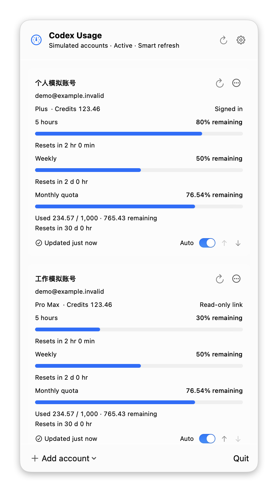

# Simple Codex Bar

View Codex and ChatGPT subscription limits for multiple accounts from the macOS menu bar. Simple Codex Bar is an independent project, not an official OpenAI product.



*The screenshot uses demo accounts and simulated readings.*

## Features

- View remaining limits, reset times, plans and available credits.
- Sign in separately or link existing Codex credentials with read-only access.
- Name and reorder accounts, and control automatic refresh for each account.
- Refresh manually or every 1, 2, 5, 15 or 30 minutes; the default is 5 minutes.
- Pause automatic refresh while the Mac is inactive and retain the last successful readings.
- Switch between relative times and local dates, English and Simplified Chinese, and enable Launch at Login.

## Requirements

macOS 14 or later on Apple Silicon or Intel, and a ChatGPT account with Codex access. Separate sign-in requires Codex CLI. An existing file-based sign-in can be linked directly. API-key accounts do not provide subscription usage.

## Installation

Build and run from the repository root with Xcode 27 or later, macOS SDK 27 or later, Swift 6.4 or later and Python 3:

```sh
./scripts/app.py build
./scripts/app.py run
```

The development bundle is `dist/dev/SimpleCodexBar.app`. To explore the app with isolated demo accounts, use `./scripts/app.py run -- --demo`. See [Development](docs/development.md) for Xcode and command-line workflows.

## Usage

Click the gauge icon in the menu bar to open the panel. Click it again, press Escape or click outside to close it. Settings is beside the header refresh button; Quit is in the footer.

### Accounts

Choose **Add Account → Sign in to a New Account** and complete the browser flow. Each sign-in uses its own `CODEX_HOME`, preserving the account used by your normal Codex CLI. Select the CLI executable if the app cannot find it. If the browser selects another account, switch accounts there and retry.

Choose **Link Current Codex Account (Read-only)** or **Choose auth.json (Read-only)** to use an existing sign-in. Linked files are reread on refresh; renew an expired sign-in through its owning Codex installation. Keychain-only credentials cannot be linked.

The current-account link uses an absolute `CODEX_HOME` from the app environment, or `~/.codex/auth.json`. Finder launches normally do not inherit shell variables; choose the file explicitly for another Codex home. The same user and workspace cannot be added twice.

Account menus provide rename, sign-in and removal. Use the arrows to change account order.

### Refresh and settings

Refresh every account with the header button or one account with its card button. Smart Refresh controls automatic requests, with a separate switch for each account. Automatic refresh pauses during lock, sleep, inactive sessions, display sleep or five minutes without input. A closed lid pauses it unless an external display is awake. Returning refreshes readings when the interval has elapsed.

Click a reset or update time to switch between relative times and local dates. In Settings, choose **简体中文** or **English** under **Interface Language** to update the interface immediately. **Launch at Login** uses macOS Login Items and may require approval in System Settings.

Readings are snapshots of the service response. Missing values remain unavailable. A failed refresh preserves the previous reading with a stale indicator; readings restored at startup have a cached indicator. The app displays current subscription limits without calculating costs or recording usage history.

## Privacy

Settings and the latest readings stay on the Mac. Authenticated requests go directly to OpenAI. Linked credentials remain read only; separate sign-ins use protected local files. The app has no telemetry and does not read conversations or browser cookies. See [Privacy](docs/privacy.md) for storage, permissions and account removal.

## Development

Use `./scripts/app.py build`, `run`, `test`, `package` and `release --dry-run`. Open `SimpleCodexBar.xcodeproj` for native Xcode development. See [Development](docs/development.md), [Localization](docs/localization.md) and [Releasing](docs/releasing.md).

## Contributing

See [Contributing](CONTRIBUTING.md). Maintained by [Mayflies](https://github.com/mayflies-app); optional support is available through [GitHub Sponsors](https://github.com/sponsors/nshcr).

Licensed under [MIT](LICENSE). Authentication and usage code draws on [CodexBar](https://github.com/steipete/CodexBar); see [NOTICE.md](NOTICE.md) for attribution.
